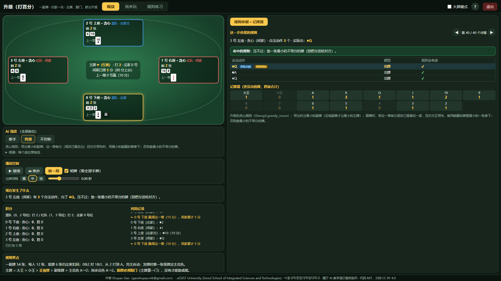
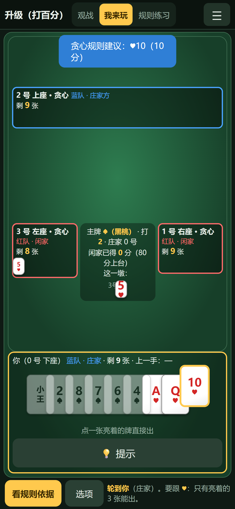

> **AI 教学演示案例 / AI Teaching Demos** 系列

# 升级（打百分）（shengji-card-engine）

**Shuyao Gao**（gaoshuyao.mk@gmail.com）· aSSIST University (Seoul School of Integrated Sciences and Technologies) · 서울과학종합대학원대학교
代码 MIT · 文档与教学素材 CC BY 4.0

**一副牌的升级（打百分）：主牌、跟门、抓分、扣底、升级轮庄全部在浏览器里运行，AI 每一步依据哪条规则都摆在右边。** 打开网页就能看 AI 对打、自己坐下打一局、或者照着任务清单练习；手机竖屏也能玩。
同一系列的中国牌类游戏：[四人斗地主](https://github.com/ShuyaoGao/four-player-doudizhu-rl)、[掼蛋](https://github.com/ShuyaoGao/guandan-card-engine)、[保皇](https://github.com/ShuyaoGao/baohuang-card-engine)、[够级](https://github.com/ShuyaoGao/gouji-card-engine)；三人斗地主见 [doudizhu-dmc-lab](https://github.com/ShuyaoGao/doudizhu-dmc-lab)。

*A browser-only Shengji (80 points) engine: trump, follow-suit, point cards and level changes, with a rule panel explaining every AI move. See the English summary at the end.*





## 怎么打开（都不需要安装）

- **手机**：点在线链接 <https://shuyaogao.github.io/shengji-card-engine/>（竖屏打开，往下滑看规则依据面板；点「我来玩」自己打）。
- **电脑**：点同一个在线链接；或者在 [Releases](https://github.com/ShuyaoGao/shengji-card-engine/releases) 下载 `shengji-card-engine-v1.1.zip`，解压后双击 `index.html`；或者点 **Code → Download ZIP**，解压后双击 `play/index.html`。

页面是纯静态网页：不需要 Python，不需要联网，不会在后台留下任何进程。Windows 上的 Edge 和手机尺寸（触屏模拟）都测过；Safari 需要在真实 Mac 上确认（见常见问题）。

## 规则（本项目实现的标准核心规则）

民间牌类变体很多，这里实现的是主流核心规则，取舍都写在下面；改规则只需改 `games/shengji.py`（和对应的 `play/js/shengji.js`）一处。

- 一副牌 54 张，每人 12 张，底牌 6 张归庄家、扣回 6 张；0&2 vs 1&3，从 2 打到 A。
- 亮主自动模拟：按发牌顺序第一张级牌定主花色；无人亮主就翻底牌第一张（王 = 无主）。
- 主牌 = 大王 > 小王 > 正级牌 > 副级牌（同大，先出为大）> 主花色 A→2；副牌各花色 A→2。
- 跟牌必须跟“门”（主牌算一门），没有这一门才可以垫牌或毙牌；一墩四张，主牌最大的赢，否则首攻花色最大的赢，赢家继续领出。
- 抓分：5 = 5 分，10、K = 10 分，全场 100 分；闲家赢最后一墩，底牌分 ×2 归闲家。
- 升级：闲家 0 分庄家方升 3 级、<40 分升 2 级、<80 分升 1 级（庄家方连庄）；≥80 分闲家上台，升 (分数-80)÷40 级。单副牌没有对子 / 拖拉机，领出只出单张。

## 怎么用

页面顶部切换三种模式：

| 模式 | 做什么 |
|---|---|
| **观战**（默认） | 所有座位都是 AI，自动对打；可以暂停、单步、调速度、明牌。 |
| **我来玩** | 你坐 0 号位，和 AI 一起打。 |
| **规则练习** | 带任务清单的「我来玩」（对手默认“新手”），做完一项自动打勾；附牌型图鉴。 |

**电脑（键盘鼠标）**：轮到你时只有亮着的牌能出（必须跟门），点一张就直接出；<kbd>T</kbd> 提示。<kbd>P</kbd> 暂停 / 继续，<kbd>N</kbd> 单步，<kbd>H</kbd> 或右上角 **?** 打开操作说明。右上角「大屏模式」把左右比例从约 45:55 调到 35:65，方便投影。鼠标停在按钮上会有带动画的小提示。

**手机（触屏，竖屏）**：头部压成一行，右上角 ☰ 里有 AI 强度、明牌、新一局、操作说明和退出。观战时牌桌在上（上面一排是其他玩家，左右两侧各一家），规则依据面板紧跟在牌桌下面（紧凑画法），往下滑看。点「我来玩」后一屏显示、不用滚动：上方是牌桌，下方是你的手牌——轮到你时只有**亮着的牌**能出，**点一张就直接出**；拿不准先点 **提示**（按钮都够大）。「看规则依据」全屏打开右栏面板，「返回」关闭。横屏时会提示竖屏体验更好。

- **右栏**：「规则依据 · 记牌器」：贪心规则这一步命中了哪一条（领出出副牌最小的 / 有分且对方领先就用最小的能赢的牌拿下 / 垫最小的不带分的牌）、可选的牌有哪些；下面是记牌器。
- **AI 强度**有几个预设（新手 = 随机、普通 = 贪心规则……），“细调”里可以逐个座位单独选。
- **公平性**：「我来玩」时对手每一步的决策过程在本局结束前锁住（候选动作会暴露它的手牌），打完自动解锁，或打开「明牌（作弊）」。💡 提示用的贪心规则只看你自己的手牌和桌面上的牌。

## 课堂上怎么用（推荐顺序）

1. **观战**：看一整场，认识主牌、跟门、毙牌、抓分和扣底翻倍。
2. **我来玩**：只有亮着的牌能出（必须跟门）。
3. **讨论**：贪心规则只看“这一墩”，不会记牌、不会算底牌——想一想怎么改进。

## 它是怎么做的

- **规则引擎**：Python 版在 `core/`（多副牌、花色、甩牌类的轮转 / 过牌 / 接风骨架）和 `games/shengji.py`；浏览器版 `play/js/core.js`、`play/js/shengji.js` 逐行移植。
- **一致性**：`tests/js/test_engine.js` 用 Python 导出的标准答案（`tests/fixtures/shengji.json`）逐步核对：同一种子发出的牌、每一步的**合法动作列表（含顺序）**、贪心智能体每一步的选择、终局名次与回报都必须相同。整场（级别、坐庄轮转、闲家上台、打过 A）也逐局核对。
- **随机数**：浏览器里用与 Python `random.Random` 完全相同的随机数序列（MT19937，`play/js/pyrandom.js`），所以同一个种子在两边发出同一副牌。
- **AI**：`agents.py` 的随机和贪心规则（自由出牌出张数最多的一手、跟牌出最小能压的普通牌、手牌 ≤8 张才用炸弹）（升级的贪心另有一套：领出最小副牌、有分就用最小的能赢的牌拿下、否则垫最小的不带分的牌）。
- **浏览器验收**：`tests/test_browser.py`（1920×1080、1366×768 跑一遍观战单步、右栏面板、我来玩一整局、练习、说明、退出）和 `tests/test_mobile.py`（390×844、414×896、360×780、768×1024 四个触屏尺寸加横屏：没有横向溢出、我来玩整页不滚动、模拟触摸点牌出牌、右栏面板打开 / 返回、没有 JS 报错）。

这个游戏没有训练好的神经网络，所以没有“大脑面板”；右栏放的是贪心规则的依据和记牌器。

### 成绩（`results/result.json`，固定种子，可复现）

每组 200 局、换边各打一半，种子 2026（`tools/run_eval.py` 调用 `evaluate.py` 的对战函数）：

| 对局 | 局数 | 该智能体所在队伍胜率 | Wilson 95% 区间 |
|---|---:|---:|---|
| 贪心 vs 随机 | 200 | 54.5% | 47.6% – 61.3% |

每组换边各打一半；胜率 = 该智能体所在队伍赢的局数 / 总局数。各游戏强弱队结构不同，50% 即为同强度。

**贪心对随机的 95% 区间包含 50%**：这套贪心规则在这个游戏里和随机出牌差不多强——它只看眼前这一墩，不记牌、不算底牌、不配合队友。想做更强的 AI，可以从这里开始改。

## 想自己跑或修改

需要 Python 3.10+：

```bash
pip install -r requirements.txt     # numpy、pytest
python evaluate.py --games 200      # 对战评估（换边各半）
python -m tools.run_eval            # 固定种子重跑评估 → results/result.json
python -m tools.export_fixtures     # 改了规则后，重新生成浏览器版的测试夹具
python -m tools.build --release     # 重新生成 play/js/credits.js，打包 release/*.zip
python -m tools.screenshots         # 重新截 README 的图（电脑 + 手机；需要 pip install playwright）
python -m pytest                    # 全部测试（JS 测试需要 Node.js；浏览器测试需要本机 Edge 和 playwright）
```

## 目录结构

```
index.html           根目录跳转页（GitHub Pages 和 Release zip 的入口，自动跳到 play/）
play/                双击即玩的静态网页（index.html、css/、js/）
  css/base.css、table.css   电脑端样式    css/mobile.css   手机竖屏样式（牌类通用）
  js/shengji.js       规则引擎（移植自 games/shengji.py）
  js/core.js          多副牌、花色、甩牌骨架、随机 / 贪心智能体（移植自 core/、agents.py）
  js/table.js         页面逻辑（模式、出牌流程、规则依据、练习、说明、退出）
  js/mobile.js        手机竖屏工具：设备判断、☰ 菜单、全屏面板、横屏提示、防误触（牌类通用）
  js/shengji_ui.js    这个游戏的界面配置（牌型名称、任务清单、图鉴……）
core/                多副牌、花色、甩牌类骨架（轮转 / 过牌 / 接风）
games/shengji.py       规则引擎（含整场：级别、进贡 / 坐庄轮转）
agents.py            随机 / 贪心智能体
evaluate.py          对战评估
results/             result.json（评估结果）
tools/               构建、评估、导出夹具、浏览器自检（edge.py）、手机尺寸验收（mobile_check.py）、截图、署名填充
tests/               Python 测试（含 test_browser.py、test_mobile.py）、tests/js（Node 差分测试）、tests/fixtures（Python 导出的标准答案）
docs/img/            截图（电脑 + 手机）
```

## 常见问题

- **关掉页面后还在后台跑吗？** 不会。这是纯静态网页，关掉标签页就全部结束，不留后台进程。「退出」（电脑右上角；手机在 ☰ 里）会先停掉所有计时器，再尝试关闭标签页；浏览器不允许关闭时，会显示“已停止运行”。
- **手机上怎么玩？** 竖屏打开在线链接。观战时往下滑看规则依据面板；点「我来玩」后点牌选中、左右滑动看更多牌，再点「出牌」「过」「提示」；「看规则依据」全屏打开右栏，「返回」关闭。
- **双击 index.html 却用记事本打开了？** 右键 →「打开方式」→ 选浏览器。
- **Mac 上能用吗？** 页面只用标准 HTML / JavaScript，Safari 应该可以打开，但作者还没在真实 Mac 上测过，遇到问题欢迎反馈。Firefox 也没有测过。
- **规则和我家乡的玩法不一样？** 很正常。这里实现的是主流核心规则，取舍都写在上面的“规则”一节里。

## 许可证与引用

代码 MIT（[LICENSE](LICENSE)），文档 CC BY 4.0（[LICENSE-docs](LICENSE-docs)），使用请注明出处。
引用信息见 [CITATION.cff](CITATION.cff)（GitHub 右侧 “Cite this repository”）。第三方组件与来源见 [THIRD_PARTY.md](THIRD_PARTY.md)。

## AI 辅助开发声明

代码由 Claude Code 辅助编写，经作者审阅。

## English summary

**shengji-card-engine** is a browser-only teaching demo of Shengji ("upgrade", one-deck 80-points variant): automatic trump declaration, trump ranking, follow-suit, point cards, buried bottom ×2, level changes and dealer rotation across a full match. The JavaScript engine reproduces the Python engine move-by-move; AIs are rule-based and a side panel explains each greedy decision. The page runs fully offline (double-click `index.html`) and works on phones in portrait mode (tap cards, scroll the hand, big play / pass / hint buttons, full-screen side panel). Code: MIT; docs: CC BY 4.0. Author: Shuyao Gao (gaoshuyao.mk@gmail.com), aSSIST University (Seoul School of Integrated Sciences and Technologies).
